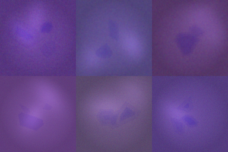
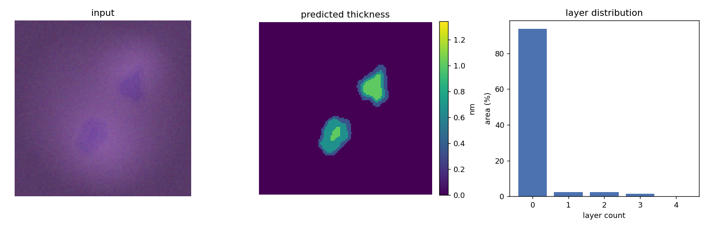

# 2D material thickness mapping

U-Net that predicts the layer count of exfoliated 2D flakes (graphene, hBN, MoS2, WSe2) on 285 nm SiO2/Si from an optical microscope image, pixel by pixel.

No hand labelling: training images are generated from a transfer-matrix model of the substrate/flake stack, so the labels come for free. Scenes get random lighting, vignetting, white balance shifts, noise and blur on top.



## Files

- `optics.py` - reflectance of N layers on SiO2/Si (transfer matrix), converted to RGB
- `dataset.py` - synthetic scenes, plus a loader for real labelled images
- `model.py` - the U-Net (~1.9M parameters)
- `train.py` - training, weighted cross-entropy, keeps the best checkpoint on validation
- `infer.py` - thickness map + layer histogram for one image
- `metrics.py` - pixel accuracy, IoU, mean layer error

## Usage

```
pip install -r requirements.txt
python train.py --epochs 15 --train-size 2000 --material graphene
python infer.py --image my_flake.jpg
python infer.py --demo        # no image, uses a synthetic one
```

Run from the repo folder. `python dataset.py` saves a few example scenes, `python optics.py` prints the layer colours.

For real data, put images in `my_data/images/` and masks with the same filename in `my_data/masks/` (pixel value = number of layers), then `python train.py --data my_data`.



## Results

About 91% pixel accuracy and 0.36 layer mean error (~0.12 nm) on synthetic test data for graphene, 0-4 layers. Not yet validated against AFM/Raman on real images, so treat it as a proof of concept.

## Things that still need work

- oxide thickness is fixed at 285 nm, and a ±10 nm change shifts colours more than one extra layer does
- optics assume white light at normal incidence, no real lamp/camera response
- refractive indices are constants (MoS2 especially is off)
- images are resized to 128x128 instead of tiled

Plan is to randomise those in training and fine-tune on a few real labelled images per microscope.

Claude (Anthropic) was used as an assistant for parts of the code and for this README.

MIT license.
